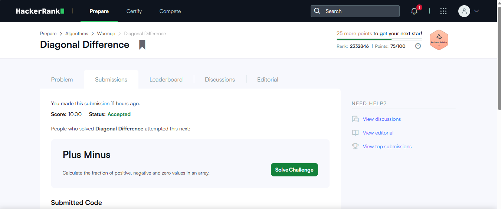
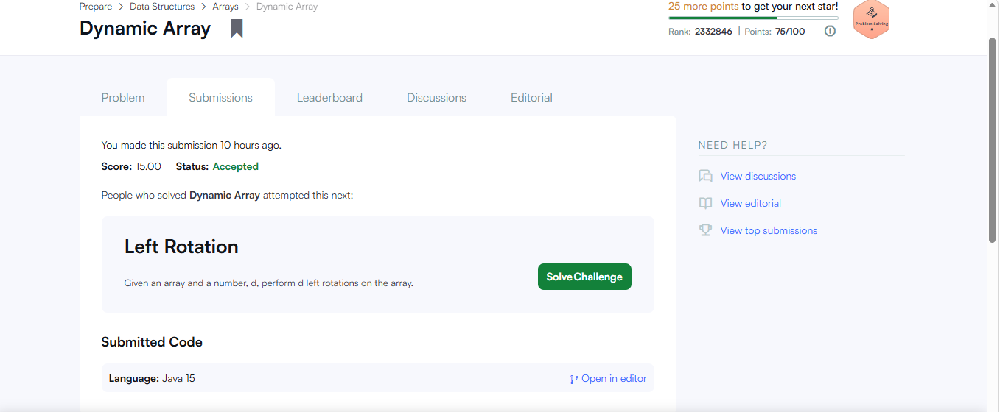
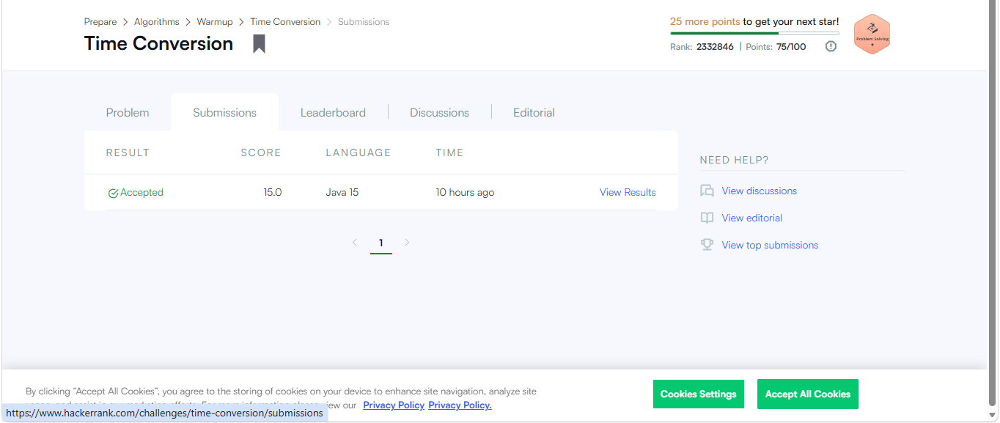
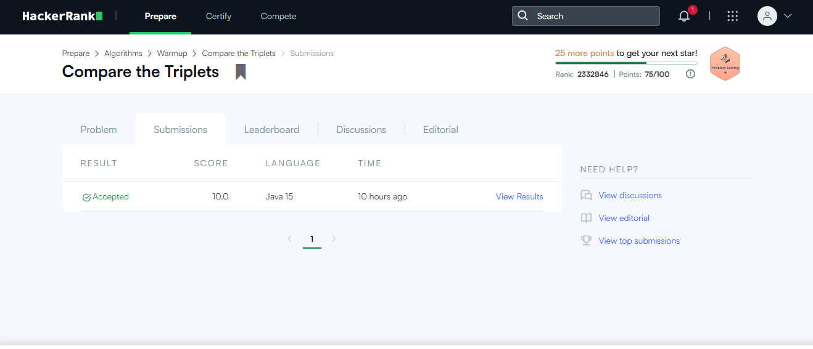
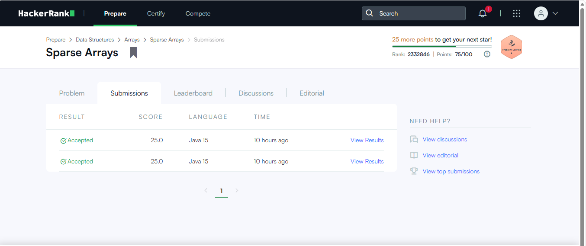


# HackerRank Algorithmic Problem-Solving Portfolio

**Student ID:** B25CS0311  
**Course:** B.Tech - Computer Science and Engineering  
**Semester:** 3rd Semester  
**Language:** Java

## 1. About This Portfolio

This repository contains solutions to the five mandatory HackerRank problems completed for Activity 8. It demonstrates array manipulation, matrix traversal, string handling, and problem-solving techniques.

## 2. HackerRank Profile

**Username:** h25020103776

**Profile:** https://www.hackerrank.com/profile/h25020103776

## 3. Problems Solved

| No. | Problem | Topic |
|---|---|---|
| 1 | Diagonal Difference | 2D Arrays |
| 2 | Dynamic Array | Data Structures |
| 3 | Time Conversion | Strings |
| 4 | Compare the Triplets | Basic Implementation |
| 5 | Sparse Arrays | Hash Maps / Strings |

## 4. Time and Space Complexity

| Problem | Time Complexity | Space Complexity |
|---|---|---|
| Diagonal Difference | O(N) | O(1) |
| Dynamic Array | O(N + Q) | O(N) |
| Time Conversion | O(1) | O(1) |
| Compare the Triplets | O(1) | O(1) |
| Sparse Arrays | O(N + Q) | O(N) |

## 5. HackerRank Badges

- Problem Solving - 3 Stars
- Java - 3 Stars

## 6. Screenshots

### Accepted Submissions

### HackerRank Badges

## 7. Tools Used

- Java
- Visual Studio Code
- HackerRank
- Git
- GitHub

## 8. Conclusion

This portfolio demonstrates the completion of five mandatory HackerRank challenges. It documents the solutions, algorithmic complexity, and skill achievements as part of Activity 8.
